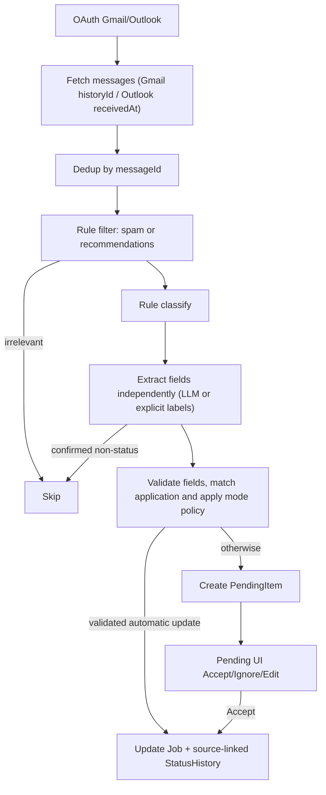

# JobGenie

Next.js 15 app for tracking job applications with email ingestion, status timeline, document uploads, and credential auth.

web app: https://jobgenie-six.vercel.app

## Key Features
- Job board (drag-and-drop), add/edit application details and posting links, uploads, auth-protected dashboard.
- Email agent: Gmail/Outlook OAuth, incremental fetch (Gmail historyId, Outlook receivedAt filter), rule+LLM parsing, relevance filtering, pending review queue, sync modes (auto/semi/strict), job/status auto-update.
- Editable/deletable status history with atomic current-state maintenance; accept/ignore pending emails.
- Batch archive/restore, status changes, and pending-email review on web and iPhone; [behavior and acceptance checks](docs/bulk-actions-acceptance.md).
- File uploads stored in MongoDB per user.

## Quick Start
```bash
npm install
npm run dev
# open http://localhost:3000
```

## Environment Variables
- `MONGODB_URI` – MongoDB connection string.
- `NEXTAUTH_URL` – base URL (e.g. http://localhost:3000 or your production domain).
- Google OAuth: `GOOGLE_CLIENT_ID`, `GOOGLE_CLIENT_SECRET`, `NEXT_PUBLIC_GOOGLE_CLIENT_ID`
- Outlook OAuth: `OUTLOOK_CLIENT_ID`, `OUTLOOK_CLIENT_SECRET`, `OUTLOOK_TENANT_ID` (or `common`), `NEXT_PUBLIC_OUTLOOK_CLIENT_ID`, `NEXT_PUBLIC_OUTLOOK_TENANT_ID`
- OpenAI (optional, for LLM parsing): `OPENAI_API_KEY`, `OPENAI_MODEL` (default gpt-4o-mini)
- Cron auth: `CRON_SECRET` (used by `/api/mail/cron?token=...`)

## Email Agent Overview
- **Auth**: Connect Gmail/Outlook via UI, tokens stored in MongoDB; auto-refresh with refresh tokens.
- **Fetch**: Incremental (Gmail historyId; Outlook by receivedAt), messageId dedupe (ProcessedEmail).
- **Parse**: Event classification and field extraction are independent; schema/date/evidence validation routes incomplete or conflicting updates to review. Marketing/recommendations are skipped.
- **Sync modes**: Auto (validated, unambiguous updates/create), Semi (matched existing applications except offers/rejections), Strict (all relevant updates to Pending). Per-user settings via `/api/sync-settings`.
- **Pending**: Review, edit key fields, accept/ignore; accept updates Job and StatusHistory.
- **Scheduling**: Use an external scheduler (e.g. cron-job.org) to call `/api/mail/cron?limit=10&token=<CRON_SECRET>`.

### Pipeline (Mermaid)


## Manual Triggers
- Logged-in user: `/api/mail` (optional `?limit=10`).
- External cron: `/api/mail/cron?limit=10&token=<CRON_SECRET>`.
- Both share validation and processing: `limit` defaults to 10 and must be an
  integer from 1 to 50 per account; invalid values return 400. Optional `provider`
  must be `gmail` or `outlook`.
- Gmail/Outlook paging resumes on the next sync when the fetch budget is reached.
  Results include fetched/stored/processed/failed/review counts, per-account
  backlogs, `hasMore` (provider pages) and `hasPendingWork` (background queue).

## Notes
- PendingItem/ProcessedEmail stored per user in MongoDB.
- Status ordering uses the email received time. Interview appointments and deadlines are stored separately; unknown scheduling times remain empty. Older emails add history without replacing newer status.
- Auto mode also requires complete validated fields and an unambiguous match. Semi automates only matched existing applications except offers/rejections. Strict reviews all relevant updates. Non-status mail is skipped.

## Reliable mail processing

Fetched messages are now stored before advancing sync cursors. A durable queue
tracks pending/processing/failed/succeeded states, retries failures on the next
sync, and commits business writes atomically with completion. MongoDB Atlas or a
replica set is required. Before rollout against an existing database, pause old
sync workers and run `npm run db:mail-indexes`.

See [mail sync reliability](docs/mail-sync-reliability.md) for rollout, legacy
record behavior, and failure recovery. Run `npm test` (Node.js 22.12+) for the
isolated replica-set integration tests; the first run downloads a MongoDB binary.

## Production build verification

Next.js and `eslint-config-next` are pinned together at `15.5.28`, the 15.x
security release in the [October 14, 2026 advisory](https://nextjs.org/blog/nextjs-security-update-october-14-2026).
Vercel blocks deployments containing known vulnerable framework versions.

Before pushing a deployment change, run both `npm test` and `npm run build` with
the required environment variables configured. Business tests alone do not cover
production compilation or Vercel's framework security gate. Commit the updated
`package-lock.json` with any dependency version changes.

## AI extraction and matching

See [the second-stage acceptance report](docs/email-matching-acceptance.md) for
mode behavior, validation, conservative name matching, source retention and stale
email protection. Fixed sample emails cover confirmation, assessment, interview,
rejection, offer, marketing and incomplete information. Pending review supports
choosing the target application; historical emails retain their source without
replacing newer state.

## Application and history editing

Use **Edit Job** on a board card to edit company, position, location, notes and
posting URL. Open the timeline and choose **Edit History** to update or delete an
event. Changes persist on refresh and update the board together with the timeline.
Current state follows the latest eligible event; deleting all eligible history
returns it to Applied. History-only emails retain their ordering protection.

See [editing acceptance and integration notes](docs/job-editing-acceptance.md).
Run `npm test` for database/API checks; after `npm run build`, run `npm run test:ui` for the optional
isolated headless Chrome acceptance (set `CHROME_BIN` outside macOS).

## Calendar and to-do

Open **Calendar & To-do** for interview appointments, assessment deadlines and
the **Upcoming**, **Overdue / past**, and **Needs a time** lists. Dates use your
browser's time zone. Create a schedule through **Update Status** on the Job Board,
or edit/delete an existing history from the calendar or timeline. Offer/rejected
applications keep their historical schedules; missing times are never replaced by
email or status-event dates. Elapsed events do not imply non-completion.

See [calendar behavior and acceptance](docs/calendar-acceptance.md). The shared
`npm test` and `npm run test:ui` commands include calendar and to-do coverage.

## In-app reminders

Use the dashboard bell to open **Reminders** and see the unread count. Reminders
default to one hour before an appointment/deadline; choose 15/30 minutes or 24
hours in settings. Mark read, snooze for 10 minutes, or cancel just that reminder.
Rescheduling starts a new occurrence; clearing/deleting a schedule or closing an
application stops reminders. Read/cancelled choices survive reload and preference
changes. Reminders refresh while the app is visible; no email/browser push is sent
when the app is closed. See [reminder rules and acceptance](docs/reminders-acceptance.md).

## Application analytics

Open **Analytics** to compare current status distribution with historical stage
conversion. Current distribution covers all saved applications; conversion uses
applications submitted within the selected dates, observed through that period's
end. Rejections never imply an interview, repeated rounds count once, and direct
offers do not invent missing stages. Select preset/custom dates and a time zone,
switch daily application/status-event trends, and inspect application progression.
See [metric definitions, date boundaries and acceptance](docs/analytics-acceptance.md).

## Mail actions and account recovery

Open **Mail** to sync immediately, continue a remaining page, retry only failed
stored emails, or review pending matches. Each account shows its live queue and
last saved result, including results from scheduled syncs. Failed-only retry does
not call Gmail/Outlook or replay successful messages.

**Remember me** keeps a login valid for 30 days; unchecked logins last 12 hours.
Both durations are fixed from sign-in. **Forgot your password?** opens the recovery
flow with one-use, 30-minute links; resetting a password signs out old sessions.
Configure server-only `RESEND_API_KEY`, `PASSWORD_RESET_FROM` (a verified sender),
and the public `NEXTAUTH_URL` before enabling real reset email delivery.
See [setup, behavior and acceptance](docs/sync-and-auth-acceptance.md).

## File uploads

**Uploads** accepts one PDF, DOCX, PNG or JPG/JPEG at a time (maximum 4 MB).
The server verifies filename, type, format signatures and DOCX container limits.
Convert legacy DOC files to PDF or DOCX for new uploads. Existing files remain
in the same collection, and all file downloads now use attachment disposition
and an inert content type. Details display metadata only, without inline previews.
See [upload rules and security acceptance](docs/upload-security-acceptance.md).

## Account and mailbox security

Mailbox connections start on the server and require a one-use, 10-minute OAuth
state bound to the signed-in session and an HttpOnly browser cookie. Google and
Outlook authorization both use PKCE S256. Invalid, expired or replayed callbacks
are rejected before exchanging the authorization code.

Login and registration use shared MongoDB quotas by IP and normalized email,
returning HTTP 429 with `Retry-After` and a visible retry message. See
[security rules, deployment configuration and acceptance](docs/account-security-acceptance.md).

## iPhone app

The native SwiftUI app lives in [`ios/`](ios/README.md). Open
`ios/JobGenie.xcodeproj` in Xcode and run the **JobGenie** scheme on an iPhone
simulator. This first increment supports native sign-in, application browsing,
creation and metadata editing, the shared schedule, and mailbox summaries.
An explicitly labeled demo mode works without an account. See the iOS README
for setup, isolated integration tests, current limits and the remaining roadmap.
Choose **Follow system**, **简体中文**, or **English** on the sign-in screen or in
**Account → Preferences → Language**. Language changes apply immediately and
persist across launches; application data keeps its original text.
