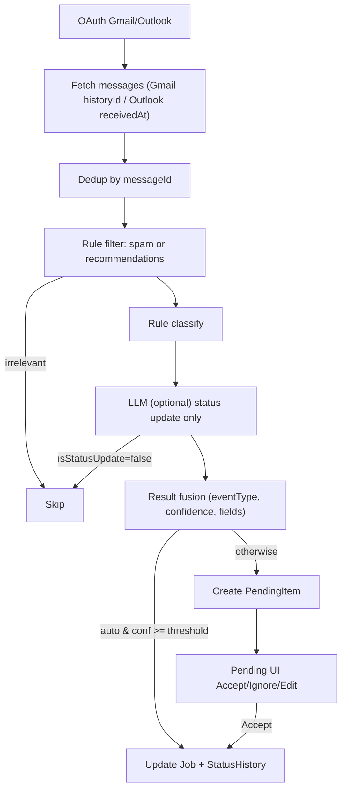

# JobGenie

Next.js 15 app for tracking job applications with email ingestion, status timeline, document uploads, and credential auth.

web app: https://jobgenie-six.vercel.app

## Key Features
- Job board (drag-and-drop), add job form, uploads, auth-protected dashboard.
- Email agent: Gmail/Outlook OAuth, incremental fetch (Gmail historyId, Outlook receivedAt filter), rule+LLM parsing, relevance filtering, pending review queue, sync modes (auto/semi/strict), job/status auto-update.
- Timeline & status history per job; accept/ignore pending items and update Job/StatusHistory.
- File uploads stored in MongoDB per user.

## Quick Start
```bash
npm install
npm run dev
# open http://localhost:3000
```

## Environment Variables
- `MONGODB_URI` – MongoDB connection string.
- `NEXTAUTH_URL` – base URL (e.g. http://localhost:3000 or your production domain).
- Google OAuth: `GOOGLE_CLIENT_ID`, `GOOGLE_CLIENT_SECRET`, `NEXT_PUBLIC_GOOGLE_CLIENT_ID`
- Outlook OAuth: `OUTLOOK_CLIENT_ID`, `OUTLOOK_CLIENT_SECRET`, `OUTLOOK_TENANT_ID` (or `common`), `NEXT_PUBLIC_OUTLOOK_CLIENT_ID`, `NEXT_PUBLIC_OUTLOOK_TENANT_ID`
- OpenAI (optional, for LLM parsing): `OPENAI_API_KEY`, `OPENAI_MODEL` (default gpt-4o-mini)
- Cron auth: `CRON_SECRET` (used by `/api/mail/cron?token=...`)

## Email Agent Overview
- **Auth**: Connect Gmail/Outlook via UI, tokens stored in MongoDB; auto-refresh with refresh tokens.
- **Fetch**: Incremental (Gmail historyId; Outlook by receivedAt), messageId dedupe (ProcessedEmail).
- **Parse**: Rule filters drop marketing/recommendations; LLM (optional) extracts structured fields; only status updates (submission/oa/interview/rejection/offer) kept.
- **Sync modes**: Auto (high-confidence updates Job/StatusHistory directly), Semi/Strict (everything goes to Pending). Per-user settings via `/api/sync-settings`.
- **Pending**: Review, edit key fields, accept/ignore; accept updates Job and StatusHistory.
- **Scheduling**: Use an external scheduler (e.g. cron-job.org) to call `/api/mail/cron?limit=10&token=<CRON_SECRET>`.

### Pipeline (Mermaid)


## Manual Triggers
- Logged-in user: `/api/mail` (optional `?limit=10`).
- External cron: `/api/mail/cron?limit=10&token=<CRON_SECRET>`.
- Both share validation and processing: `limit` defaults to 10 and must be an
  integer from 1 to 50 per account; invalid values return 400. Optional `provider`
  must be `gmail` or `outlook`.
- Gmail/Outlook paging resumes on the next sync when the fetch budget is reached.
  Results include fetched/stored/processed/failed/review counts, per-account
  backlogs, `hasMore` (provider pages) and `hasPendingWork` (background queue).

## Notes
- PendingItem/ProcessedEmail stored per user in MongoDB.
- OA/Interview times use parsed scheduledTime when available, otherwise email received time; submission/offer/rejection use received time.
- Auto mode only applies to status updates with confidence above the user threshold; others go to Pending or are skipped if non-status.

## Reliable mail processing

Fetched messages are now stored before advancing sync cursors. A durable queue
tracks pending/processing/failed/succeeded states, retries failures on the next
sync, and commits business writes atomically with completion. MongoDB Atlas or a
replica set is required. Before rollout against an existing database, pause old
sync workers and run `npm run db:mail-indexes`.

See [mail sync reliability](docs/mail-sync-reliability.md) for rollout, legacy
record behavior, and failure recovery. Run `npm test` (Node.js 22.12+) for the
isolated replica-set integration tests; the first run downloads a MongoDB binary.

## Production build verification

Next.js and `eslint-config-next` are pinned together at `15.5.28`, the 15.x
security release in the [October 14, 2026 advisory](https://nextjs.org/blog/nextjs-security-update-october-14-2026).
Vercel blocks deployments containing known vulnerable framework versions.

Before pushing a deployment change, run both `npm test` and `npm run build` with
the required environment variables configured. Business tests alone do not cover
production compilation or Vercel's framework security gate. Commit the updated
`package-lock.json` with any dependency version changes.
