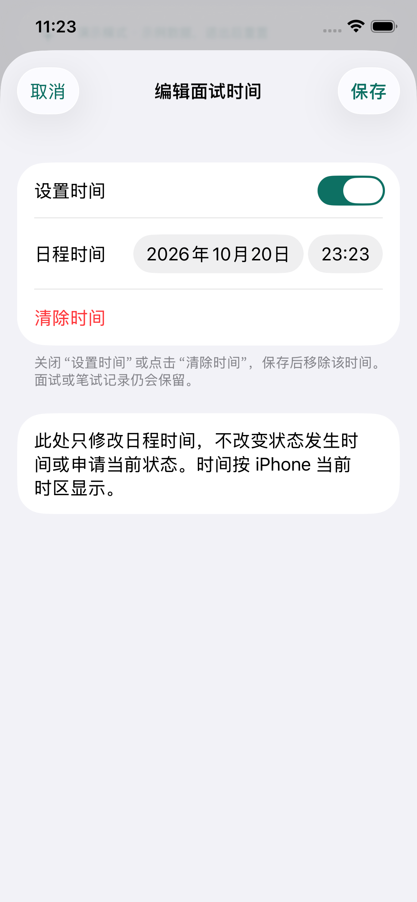

# iOS 日程编辑验收

## 使用方式

- 日程页每条记录提供“编辑面试时间”或“编辑笔试截止时间”，以及“查看申请详情”。
- 申请详情的每条状态历史都提供两个时间编辑入口，因此没有日程的历史也可以补时间。
- 打开“设置时间”选择日期、时刻；修改已有日期后保存即可改期。“清除时间”或关闭开关，再保存，才会清除服务器记录中的对应时间。取消或关闭弹窗不提交。
- 中英文即时切换；日期按所选界面语言格式化，时区使用 iPhone 当前时区，接口使用 UTC ISO 时间并保留毫秒。

## 一致性规则

使用现有 `PATCH /api/jobs/:jobId/status-history/:historyId`，每次只发送 `scheduledTime` 或 `deadline`，清除时发送显式 `null`。不会提交另一项时间、状态、历史发生日期、邮件来源或状态生效标记。服务端仍负责归属与父子关系校验，以及日程对应的提醒版本更新。

修改成功后用服务端返回的申请、历史更新 App，再强制刷新统一日程列表。列表刷新失败时保留已确认的修改并提供刷新错误提示。旧列表和详情请求不能覆盖已确认修改。保存失败保留编辑内容以便重试；401 清理会话。没有离线写入队列。

清除时间保留状态历史。仍处于 interviewing 的面试记录进入“时间待补充”；笔试以阶段 `Online Assessment` / `OA` / `笔试` 或无阶段时的邮件来源 `oa` 识别，缺截止时间时显示待补充。其他状态且两个时间都为空的历史不产生日程。演示投影与网页规则一致。

日程跳转详情不依赖申请列表预加载；详情自行读取申请和历史。下拉刷新及返回前台读取服务器变更。跨设备为刷新后一致，不声称实时推送。

## 自动化验收

2026-10-19：31 项 iOS 核心测试、4 项演示/语言 UI 测试、2 项真实后端/网页互通 UI 测试，合计 37 个不同测试分批通过。64 项服务端回归通过。Debug、未签名 iPhone arm64 Release、脚本 ESLint、工程 plist 及 diff 检查通过。日程 UI 首次运行因自动化点击落在开关标签处失败；调整到系统开关控件后重跑通过。

- `ScheduleTests`：单字段 PATCH、null 清除、另一字段与历史状态保留、毫秒及跨午夜时区、无效日期、面试/笔试缺失时间分类、演示改期与删除、未缓存申请详情、刷新失败时保留已确认修改、401 清理、中英文文案。
- 模拟器日程 UI：清除后移出即将到来、待补充重新设置、跳转详情、补截止时间、取消清除不保存、真正清除、英文编辑标题。
- 隔离联调：App 设置面试及截止时间，重启后日程保留；数据库确认两个时间及提醒版本；网页读取原生时间后清除面试时间、修改截止时间；App 刷新显示网页修改并再次清除截止时间，数据库确认清除且当前 Offer 状态保留。
- 权限：使用另一用户的历史，及当前申请搭配他人的历史 ID 修改时间均为 404；未登录写入为 401。沿用现有 64 项历史、日程和提醒回归。

复现命令见 [iOS README](../ios/README.md)。真实后端验收使用 `ios/scripts/verify-backend.mjs`，创建临时 MongoDB 副本集、账号、Next.js 服务和全新浏览器配置。不使用生产账号、数据库或邮箱。

本次范围是原生日程编辑，不包含 APNs 推送、真机签名或 TestFlight 验收。
