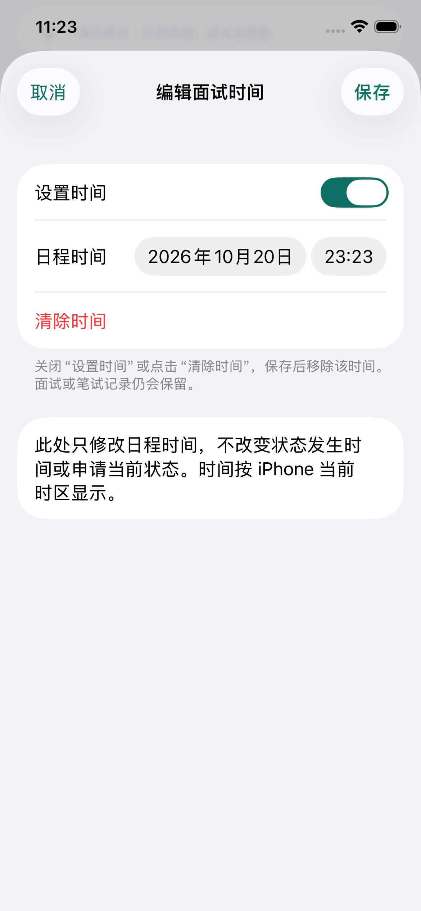

# iOS schedule editing acceptance

English translation prepared on 2026-11-04 (Asia/Shanghai). Historical results and acceptance boundaries below refer to the original delivery, not a new test run. The iOS app retains Chinese/English localization.

## Usage

Schedule entries provide interview-time/assessment-deadline editing and application-detail navigation. Every history entry in details provides both time editors, including entries with no current schedule. Enable Set time and choose date/time to add or reschedule. Clear time or disable the switch, then save, to clear the server value. Cancelling/dismissing does not submit.

UI switches immediately between Chinese and English. Dates follow the selected UI locale and phone timezone; APIs use millisecond UTC ISO dates.

## Consistency

Use `PATCH /api/jobs/:jobId/status-history/:historyId`, sending only `scheduledTime` or `deadline`; explicit `null` clears it. Preserve the other time, status, history date, email source and status eligibility. The server checks ownership/parent relationships and updates reminder versions.

Apply confirmed server application/history results, then force-refresh unified schedules. If refreshing fails, keep the confirmed edit and show the refresh error. Stale list/detail responses cannot overwrite confirmed writes. Save failure retains edits; 401 clears the session. No offline write queue is implemented.

Clearing a time keeps history. An interviewing entry missing its interview time becomes a missing-time event. Assessment stages `Online Assessment`, `OA` or the supported Chinese assessment label, or source `oa` when no stage exists, identify an assessment missing a deadline. Other statuses with neither time produce no event. Demo projections follow web rules.

Navigation loads details independently of a preloaded application list. Pull-to-refresh/foreground refresh reload server changes. Cross-device consistency requires refresh and is not real-time push.

## Results on 2026-10-19

31 iOS core tests, four demo/language UI tests and two real-backend/web interoperability UI tests passed across runs: 37 distinct tests. Also passed 64 server regressions, Debug, unsigned iPhone arm64 Release, script ESLint, project/plist and diff checks. The initial schedule UI run tapped the switch label; a corrected control locator passed on rerun.

- `ScheduleTests`: single-field PATCH, null clearing, preservation of other fields/status, milliseconds and cross-midnight timezones, invalid dates, missing-time classification, demo rescheduling/deletion, uncached details, keeping confirmed edits after refresh failure, 401 and both languages.
- Simulator UI: clear upcoming time, restore missing time, open details, add deadline, cancel clearing, actually clear and verify English titles.
- Isolated integration: App saves both times and survives relaunch; database confirms times/reminder versions. Web reads them, clears the interview and changes the deadline; App refresh sees changes and clears the deadline. The database confirms cleared times while Offer status remains.
- Ownership: another user's history or wrong-parent history returns 404; unauthenticated writes return 401. Existing history/schedule/reminder regressions passed.

Commands: [iOS README](../ios/README.md), using `ios/scripts/verify-backend.mjs` with temporary MongoDB replica set, accounts, Next.js and fresh browser profiles. No production accounts/data/mail. APNs, device signing and TestFlight are outside this milestone.
